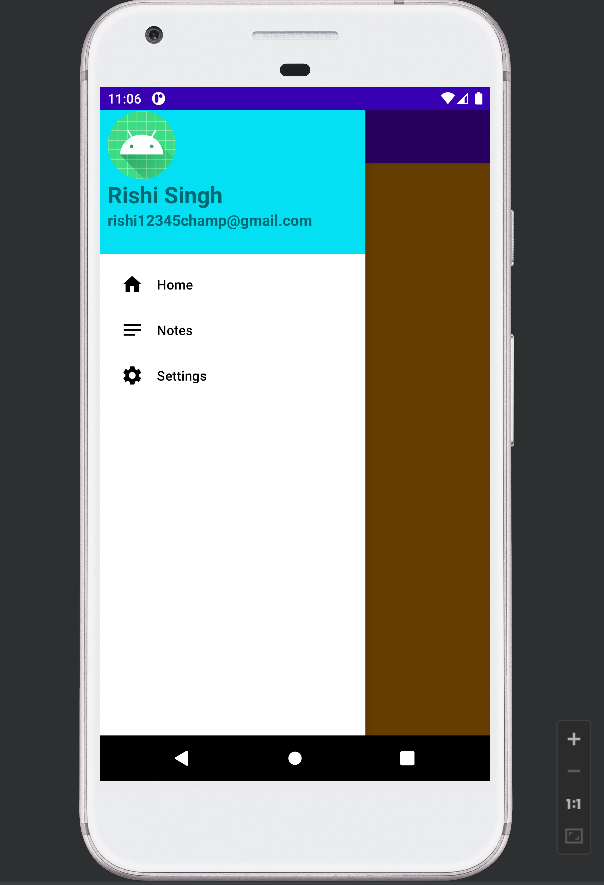

# Navigation Drawer Android App

This Android project demonstrates how to implement a **Navigation Drawer using Java, Fragments, and AndroidX components** in Android Studio.

The app provides a side navigation menu that allows users to switch between different sections of the application.

---

## Purpose

This project was created as a learning exercise to understand how to implement a **Navigation Drawer in Android applications** using Java and Fragments.  
It demonstrates how to integrate **DrawerLayout, NavigationView, Toolbar, and Fragment transactions** to build a simple navigation-based user interface.

---

## Features

- Navigation Drawer integrated with Toolbar
- Fragment-based navigation
- Home menu loads a fragment
- Notes and Settings menu options
- Toast messages on menu selection
- Drawer closes automatically after item selection
- Back button closes the drawer if open

---

## Technologies Used

- Java
- Android Studio
- AndroidX Libraries
- DrawerLayout
- NavigationView
- Toolbar
- Fragments

---

## Project Structure

Main components of the application:

- `MainActivity.java` → Handles Navigation Drawer setup and menu interactions  
- `AFragment.java` → Fragment displayed when the Home option is selected  
- `activity_main.xml` → Layout containing DrawerLayout and NavigationView  
- `navigation_menu.xml` → Defines menu items inside the navigation drawer  

---

## How the App Works

1. The application launches with a **Toolbar and Navigation Drawer icon**.
2. Clicking the icon opens the **side navigation menu**.
3. Available menu options:
   - **Home** → Loads `AFragment`
   - **Notes** → Displays a Toast message
   - **Settings** → Displays a Toast message
4. If the drawer is open, pressing the **Back button closes the drawer** instead of exiting the application.

---

## Screenshots

  

---

## 2026 update

- **Tooling:** upgraded from Gradle 7.3 / AGP 7.2 (which don't run on the JDK 21 in current Android Studio) to Gradle 8.11.1, AGP 8.7.3, compileSdk 35 / targetSdk 34, Java 17 and current AndroidX libraries.
- Choosing **Home** added a new copy of the screen on top of the old one every time (fragments were `add`ed, not `replace`d); rotating the phone stacked another. Now there is always exactly one.
- Replaced the deprecated `onBackPressed()` with an `OnBackPressedCallback`; Back still closes an open drawer before leaving.
- **Tests:** 4 on-device UI tests (drawer, repeated Home, rotation, Back), all passing on an Android 11 emulator, plus a 2,000-event monkey stress test with no crashes. GitHub Actions builds, unit-tests and lints the app on every push.

## Author

Rishi Singh
